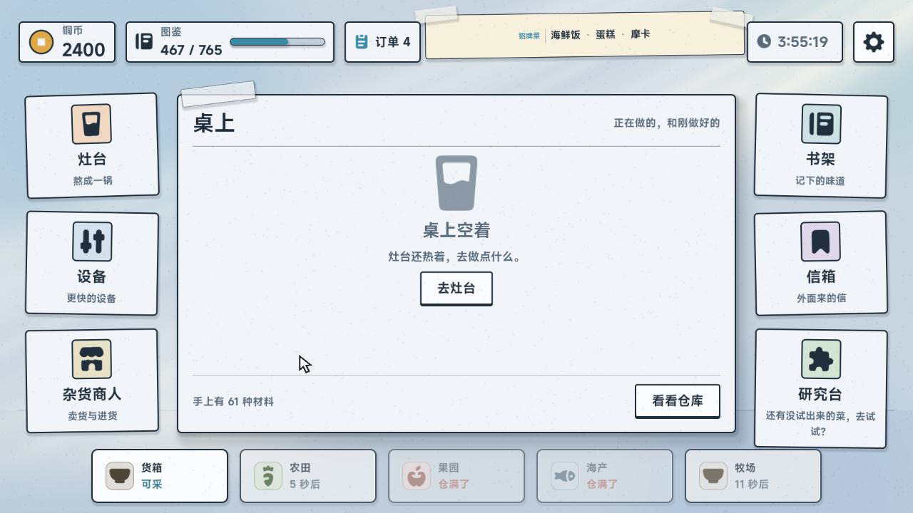
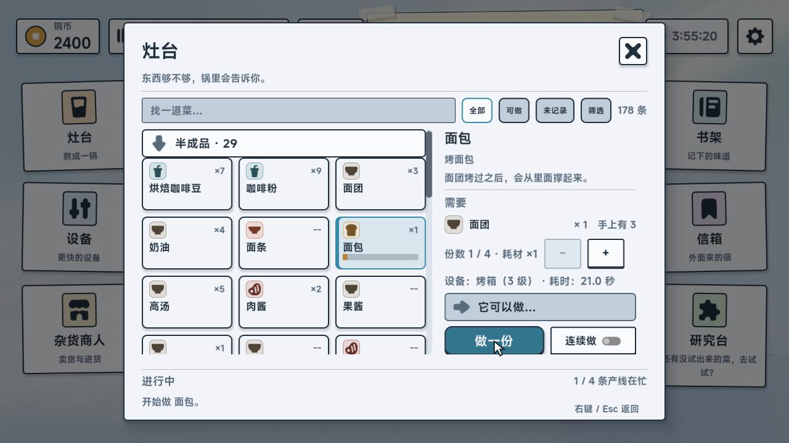

# 随食出发 / Off the Eaten Path (DEMO)

叙事向放置烹饪 + 美食图鉴收集。单机、16 种语言、Windows / Web。

> 当前为试玩 DEMO 快照，内容与数值可能继续调整。
> 本仓库只同步 DEMO 与必要修复；后续版本（含手柄支持与新内容）不在这里更新。
> 完整版与商店页面：待公布。

| | |
|---|---|
|  |  |
| 桌面：信、锅与采集点 | 灶台：配方、份数与耗时 |

内容量：288 道菜 · 69 封信 · 33 件任务 · 765 条图鉴 · 11 个主题；主线约 5–6 小时（估算）。

## 运行

- 引擎：Godot 4.7.2 standard（非 mono；工程无 C#）。
- 命令：godot --path .
- 测试（GUT 9.6，58 scripts / 530 tests）：godot --headless --path . -s addons/gut/gut_cmdln.gd -gdir=res://tests -gexit

## 反馈

- 问题与建议：https://github.com/0999312/OffTheEatenPath/issues
- 中文玩家 QQ 群：**1045897157**（《随食出发》游戏玩家反馈群）
- 国际 Discord：https://discord.gg/S33q9jNKwU

Steam 社区与 itch 页面开放后会在这里补上链接。

## 许可

- 代码：MIT（见 LICENSE）。
- 第三方素材与字体：见 THIRD_PARTY.md。
- 背景音乐不在本仓库内分发（单座 EULA），运行时会自动跳过缺失曲目。
